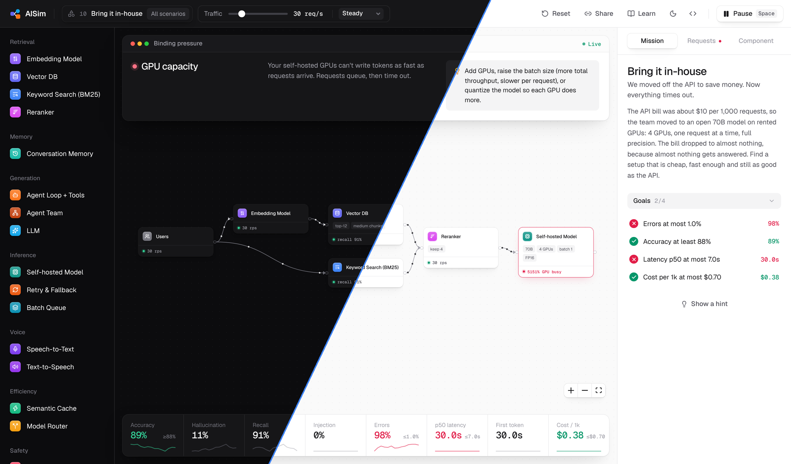

# AISim: AI System Design Simulator

**Live demo: [ai-system-simulator.vercel.app](https://ai-system-simulator.vercel.app/)**

Build an AI system from parts, push real-shaped traffic through it, and watch which part breaks first. Then fix it and push harder.

[](https://ai-system-simulator.vercel.app/)

The point isn't memorising components. It's learning to name the **binding pressure**: the one limit hurting your system right now.

AI systems fail in two ways at once:

- **Load**: rate limits (tokens per minute), latency, cost, context windows
- **Quality**: hallucinations, retrieval misses, prompt injection, runaway agents

AISim models both, so you can feel the trade-offs that make AI engineering different from classic system design.

## Scenarios

| # | Scenario | First wall | What you learn |
|---|----------|------------|----------------|
| 1 | The docs chatbot | Missing knowledge | RAG: grounding beats a bigger model |
| 2 | Confidently wrong RAG | Retrieval recall | Hybrid search, chunk size, reranking |
| 3 | Launch day | Tokens-per-minute limit | Semantic caching, model routing, cost per request |
| 4 | The support agent | No way to act | Agents, step budgets, runaway-loop cost |
| 5 | Someone pasted a jailbreak | Prompt injection | Layered guardrails and their false positives |
| 6 | The contract reviewer | Context window overflow | Context as a budget, reranking to fit small models |
| 7 | "It feels slow" | Time to first token | Streaming, and what silently breaks it |
| 8 | The chat that never ends | History bloat | Stateless models, conversation memory strategies |
| 9 | Flying blind | No quality visibility | Evals, LLM-as-judge, measuring before optimising |
| 10 | Bring it in-house | GPU capacity | Self-hosting, batching, quantization, GPU cost |
| 11 | The provider is down | Provider outage | Retries, retry storms, failover |
| 12 | The research assistant | One agent doing everything | Multi-agent teams, hand-offs, reviewers, round caps |
| 13 | Think harder? | Model capability | Reasoning models, thinking budgets, routing |
| 14 | It broke the parser | Broken structured output | JSON mode, schema validation |
| 15 | Yesterday's answers | Stale index | Ingestion, re-indexing, layout-aware parsing |
| 16 | The 20-page system prompt | Paying for the same prompt again | Prompt caching |
| 17 | The nightly job ate the day | Background jobs in the fast lane | Batch APIs, async work, rate limits |
| 18 | Fine-tune it? | Your custom labels | Fine-tuning vs RAG vs prompting, small tuned models |
| 19 | Nothing changed. Everything broke. | Flying blind, then model drift | Version pinning, regressions, evals |
| 20 | Compliance is calling | Personal data leaving | PII redaction, data retention and residency |
| 21 | The walkie-talkie | Seven seconds of silence | Voice pipelines, STT/TTS, streaming every stage |
| 22 | One user, half your bill | Scripted abuse | Per-user limits, quotas, cost control |
| 23 | Same question, different answers | Sampling noise | Temperature, top-p, determinism, JSON mode |
| 24 | The evals say it's fine | Evals that lie, then retrieval misses | Representative test sets, LLM-as-judge bias, calibrating against humans |
| 25 | The email that hijacked the agent | Indirect prompt injection | Untrusted content, least privilege, approval for risky actions, the lethal trifecta |
| — | Sandbox | Whatever you hit | Free build; set your own traffic mix |

## Features

- **Binding pressure**: a live diagnosis of the one limit hurting your design most, with what to try next.
- **Telemetry dock**: accuracy, hallucination, recall, injection, errors, latency, time to first token and cost, with goal targets and trend lines.
- **Request inspector**: open the Requests tab, click any sampled request and follow it hop by hop (what each component did, how long it took, and why it failed). Its path lights up on the canvas.
- **Guided tour**: an 11-step walkthrough that spotlights each part of the screen (scenarios, mission, canvas, components, run, traffic, binding pressure, live numbers, request inspector, Learn, share). It's offered after the welcome screens, and the ? button in the top bar replays it.
- **Scenario picker**: search and difficulty filters, cards with difficulty, the concepts each scenario teaches, and your progress (saved in your browser).
- **Learn**: a learning journey of 10 modules (Beginner → Advanced) and 34 short lessons, from how models are made to fine-tuning, privacy, voice and abuse controls, searchable, including a full Inference module (prefill vs decode, GPUs and batching, self-hosting vs API, reliability) and multi-agent systems in plain language, each linked to the scenario that practises it, with your reading progress saved. Plus a searchable glossary of 126 AI terms, each with a simple definition, an everyday analogy and why it matters. Every component's settings panel links to its glossary entry.
- **Traffic patterns**: steady, spikes (4× bursts), a daily wave, or a ramp, with a simulation clock.
- **Sandbox traffic mix**: sliders for docs questions, exact-term lookups, tool requests, attacks, easy requests, repeats, chat length and references back to earlier messages.
- **Mobile friendly**: on phones the layout stacks into pressure, canvas, telemetry and mission; modals become full-height sheets.
- **Light and dark mode**: follows your system setting until you pick one with the toggle in the top bar.
- **Share**: copies a link that encodes your whole design, so anyone can open and run it.

## Components

Users · Input Guardrail · Semantic Cache · Model Router · Conversation Memory (full / sliding window / rolling summary / long-term retrieval) · Embedding Model · Vector DB (top-K, chunking, re-indexing, document parsing) · Keyword Search (BM25) · Reranker · Agent Loop + Tools · Agent Team (workers, reviewer, max rounds) · Per-user Limits · PII Redactor · Content Sanitiser · Action Approval · Speech-to-text · Text-to-speech · LLM (small / medium / large, thinking budget, provider A/B, streaming, JSON mode, prompt caching, fine-tuned, pinned / latest version) · Self-hosted Model (open 8B/70B, GPUs, batch size, quantization) · Retry & Fallback · Batch Queue · Output Judge · Output Validator · Eval Harness

## How to play

1. Pick a scenario and read the brief and goals.
2. Press **Run** (or Space). The metrics bar and the **Binding pressure** panel update live.
3. Add components from the left, then drag from a node's right dot to the next node to connect them. Click a node to tune it.
4. Hold every goal for a few seconds to clear the scenario.

## How it works

No real models are called. The engine (`src/engine/simulate.ts`) is a deterministic Monte-Carlo model:

- Each tick samples ~1,500 requests from the scenario's **traffic profile**: how many need private knowledge, hinge on exact identifiers, need a tool, are adversarial, are easy, or are repeats.
- Only nodes on a path **Users → … → LLM** (plus anything after a live LLM, such as an output judge) take part.
- Each component changes a request's latency, cost and outcome. Examples:
  - Recall depends on top-K, chunk size and vector vs. keyword search.
  - Too many unranked chunks cause "lost in the middle" errors.
  - Agents multiply LLM calls, and ~10% of runs get stuck.
  - Tokens per minute are checked against each model's rate limit, producing 429s.
- Outcomes (correct, hallucinated, declined, blocked, injected, rate-limited, overflow) roll up into metrics, and `src/engine/pressures.ts` names the dominant failure cause against the scenario's goals.

The numbers are calibrated to be *directionally* right (relative prices, latencies, failure modes) so the lessons hold up in real systems. They're not benchmarks.

## Playing it

New visitors land on a welcome screen with **Play level 1**. Level 1 is coached step by step: the guide points at what to do next and waits until you do it (press Run, add a component, watch it improve). After that you're on your own, with help if you need it:

- **Tap to add:** tapping a component in the list connects it where it belongs in the pipeline. Deleting one reconnects its neighbours. You can still drag and rewire by hand.
- **Components unlock as you play.** Every component is listed; ones you haven't reached are greyed out with a lock and the level that unlocks them. New ones are marked *New*. Sandbox and "Unlock every level" open everything.
- **Customer complaints** pop up over the canvas while things are failing ("Same invoice, two different totals?!"), so problems read as people, not just numbers.
- **Hints when you're stuck:** after 25 seconds without progress the guide points at the binding pressure, then shows the level's hint, then highlights a component to try.
- **Level map and stars:** the 25 levels sit in five chapters; clearing one unlocks the next (or tick "Unlock every level"). Each level awards up to three stars: clear it, keep it within budget (par is the reference solution's cost, plus a little slack), and build it lean (no more components than the reference). Improving your best celebrates again.
- **What you just learned:** the win card shows your stars, why you got them, the level's key takeaway and a link to the full lesson.
- **Share your result:** the win card's "Share result" draws a 1200×630 image of your before → after numbers (e.g. accuracy 23% → 77%) and stars. Phones open the share sheet; desktops download it and copy a post to paste.
- **Sound effects:** small synthesised sounds for adding parts, running, new problems, goals met and level clears. Off by default (toggle in the top bar or on the welcome screen).
- **Voice guide:** the guide reads its messages aloud. The speaker button in the top bar (or "Choose voice" on the welcome screen) turns it on or off, picks any English voice the device has, sets the speed and plays a sample. Captions are always shown.

### Natural voice clips

Out of the box the voice uses the browser's built-in speech. To use a natural recorded voice instead, generate a clip for every line once:

```bash
OPENAI_API_KEY=sk-... npm run voice                  # OpenAI TTS (VOICE=nova by default)
ELEVENLABS_API_KEY=... ELEVENLABS_VOICE_ID=... npm run voice
```

This writes `public/voice/*.mp3` and a manifest. The app plays a clip when one exists and falls back to the browser voice otherwise. Re-running only records lines whose text changed.

## Development

```bash
npm install
npm run dev     # local dev server
npm test        # engine tests: every scenario starts broken and its reference solution wins
npm run tune    # prints metrics for each scenario's start vs. solution (handy when tuning)
npm run build   # static build in dist/
```

The build is a static site. It's deployed on Vercel (every push to `main` redeploys), and it works as-is on Cloudflare Pages, Netlify or GitHub Pages too (build command `npm run build`, output `dist`).

### Adding a scenario

Add an entry to `SCENARIOS` in `src/engine/scenarios.ts` with:

- a traffic profile
- goals
- a broken starting graph
- a hint and a lesson
- a `solution` graph

The test suite checks that the start fails and the solution clears every goal, so scenarios can't silently become unwinnable when the engine changes.

## Roadmap ideas

- More scenarios: long documents (context overflow), latency SLOs and streaming, multi-tenant rate limits, eval-driven prompt changes
- Request inspector: click a failed request to see its path and why it failed
- Charts over time and traffic spikes
- "Real mode": swap one node for a real embedding model or vector search over a sample corpus
- Shareable designs via URL

## Credits

Inspired by the [System Design Simulator](https://system-design-simulator.ishukpong418.workers.dev/) and its idea of naming the binding pressure.

Built by [Joshua Paul (cybernerdie)](https://joshuapaul.me).
